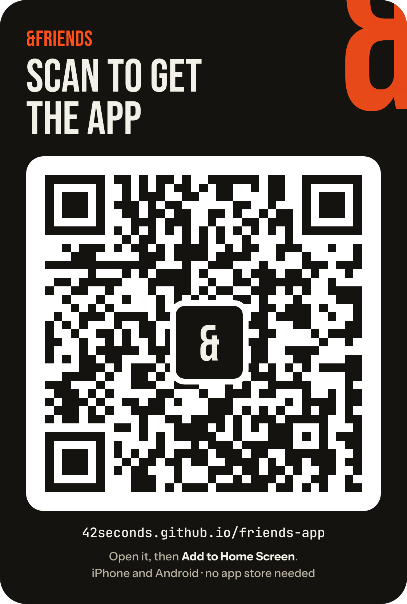
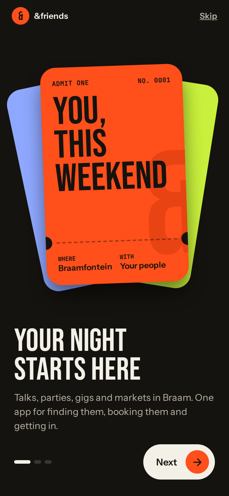
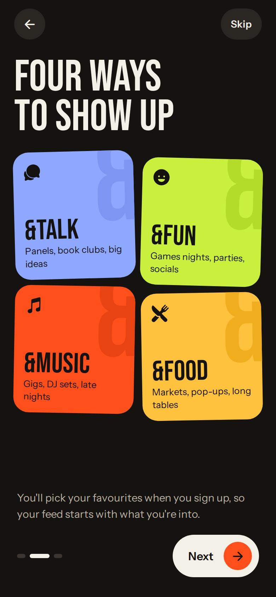
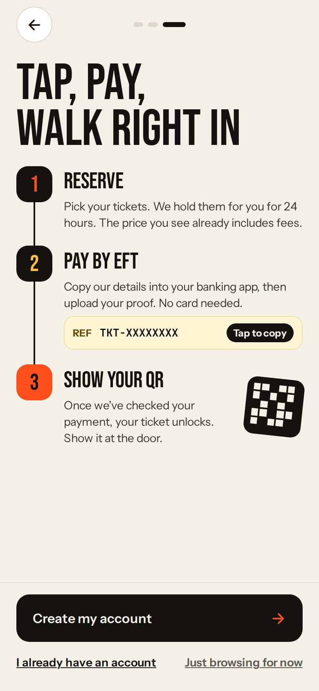
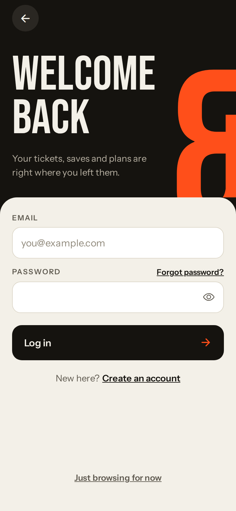
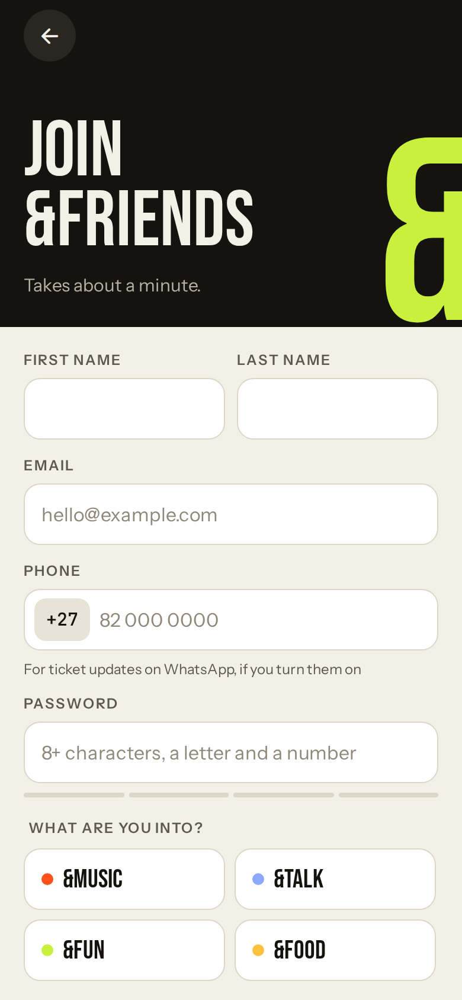
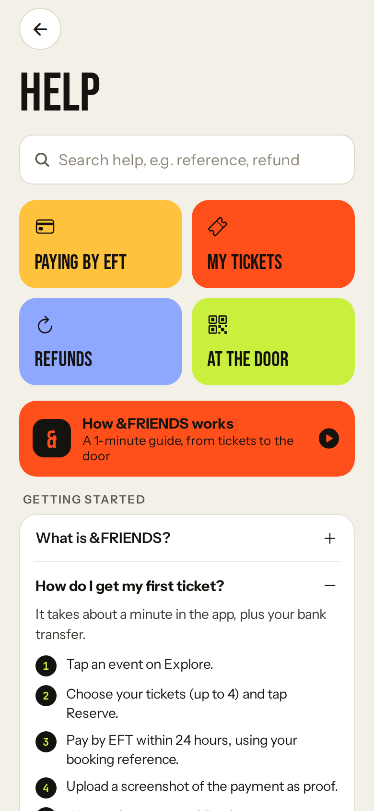

<p align="center">
  
  
</p>

<p align="center">
  <b>Braamfontein's events app.</b> Find a night out, reserve tickets, pay by EFT and walk in with a QR code.
</p>

<p align="center">
  <a href="https://42seconds.github.io/friends-app/"><b>Open the app</b></a> ·
  <a href="#get-the-app">Get it on your phone</a> ·
  <a href="#run-it-yourself">Run it yourself</a>
</p>

<p align="center">
  <a href="https://42seconds.github.io/friends-app/"></a>
</p>

---

## The app

<p align="center">
  
  
  
</p>
<p align="center">
  
  
  
</p>

&FRIENDS brings Braamfontein's gigs, talks, games nights, markets and food pop-ups into one
app, grouped into four sub-brands: **&Music**, **&Talk**, **&Fun** and **&Food**.

**For guests**
- Browse this week's events, filter by sub-brand, price and date, search and save events; past events under *Recently*
- Reserve up to 4 tickets per person, **mixing ticket types** in one booking (e.g. 2 General + 1 VIP). They are held for 24 hours while you pay by EFT
- **Early bird** tickets with their end date, **"only N left"**, and **sold out → join the waitlist** for that ticket type
- Copy the bank details and booking reference, upload proof of payment, and follow the check on a live timeline
- **Emails** in the &FRIENDS design: *Held for you*, *You're in!* and *Quick fix needed*
- Get a notification the moment your payment is approved, then show one QR code at the door; the stub tears off when you're scanned in
- Send a ticket to a friend, release it to the waitlist, or join the waitlist for sold-out nights
- A first-time guide, one-time tips on the real screens, and a guided first payment
- Works offline: saved events, bookings and QR tickets open without signal

**For staff**
- Review proofs of payment and approve or reject them with a reason
- Scan QR codes at the door (scans made offline sync later), and search the guest list
- Make discount and free guest-list **access codes**
- Show the **app QR code** to guests at the door

**Accounts**
- Register with clear password rules (shown as you type) and confirm the email with a **6-digit code**
- Log in with email and password, or with **fingerprint, face or the phone's PIN** after the first login
- **Admins use 2-step verification**: password plus an emailed code
- Password reset by email, editable profile, notification settings and a 5-second log-out

## Get the app

### Any phone: scan the QR code (recommended)


Scan the QR code above with the phone's camera, or open
**[42seconds.github.io/friends-app](https://42seconds.github.io/friends-app/)**. Then:

- **iPhone (Safari):** tap **Share → Add to Home Screen**.
- **Android (Chrome):** tap **Install the app** on the Explore screen, or **⋮ → Install app**.

It gets its own icon, opens full screen and **works without signal**. Same accounts, events and
tickets as the Android app, and it updates itself. No download and no app store needed.
Staff can show the same QR code in the app: **Settings → Get the app**, or **Staff mode → App QR code**.

<br clear="right">

### Android app (APK)

The installed Android app also has push notifications and fingerprint sign-in.

1. Open the [latest release](https://github.com/42seconds/friends-app/releases/latest), or the newest green
   run in [GitHub Actions](https://github.com/42seconds/friends-app/actions) under **Artifacts**,
   and download the `.apk` file.
2. Open it on your phone and allow installing from this source when asked.

## Run it yourself

You need [Node.js 22](https://nodejs.org) and Git.

```bash
git clone https://github.com/42seconds/friends-app.git
cd friends-app
npm install --legacy-peer-deps
npx expo start
```

Scan the QR code with **Expo Go** (Android) or the **Camera** app (iPhone), or press **w** to open
it in the browser. If your phone can't connect, use `npx expo start --tunnel`.

| Command | What it does |
|---|---|
| `npm test` | Unit tests (Jest) |
| `npm run typecheck` | TypeScript check |
| `npm run test:rules` | Firestore security rules tests on the local emulator |
| `npm run test:otp` | Email code flow tests (local emulators and a fake mail server) |
| `npm run seed` | Adds sample data (10+ records per collection) |
| `npm run build:web` | Builds the installable web version (with offline support) |
| `npm run deploy:web` | Builds and publishes the web version to Firebase Hosting |

## How it's built

| Part | Technology |
|---|---|
| App | React Native with Expo (SDK 58), Expo Router, TypeScript |
| Database | Cloud Firestore, with security rules for residents and admins |
| Accounts | Firebase Authentication (email and password, Google sign-in), email codes, fingerprint sign-in (expo-local-authentication) |
| Notifications | Expo Notifications and Expo push service |
| Offline | Data saved on the phone (AsyncStorage) and NetInfo; a service worker for the web app |
| Web app | Installable web app (PWA) on GitHub Pages |
| Emails | EmailJS (code emails and booking emails) |
| Tests | Jest unit tests, Firestore rules tests and email-code tests on the Firebase emulators |
| CI/CD | GitHub Actions and Azure Pipelines (test, build the APK, deploy the web version) |
| Planning | Azure Boards (epics, features, user stories over 7 sprints) |

```
app/            screens (Expo Router: one file per screen)
src/
  components/   shared UI (buttons, cards, coach marks, offline banner)
  services/     Firebase: auth, events, tickets, payments, users
  hooks/        data hooks (events, bookings, tickets, profile)
  lib/          pure logic: pricing, dates, validation, offline cache, push
__tests__/      unit tests
tests/rules/    Firestore security rules tests
docs/           Azure DevOps setup, push notifications, website notes
```

## DevOps

- **GitHub Actions** ([`.github/workflows/ci.yml`](.github/workflows/ci.yml)), on every push and pull request:
  typecheck and unit tests, Firestore rules and email-code tests, an Android APK and an iOS simulator
  build. Every push to `master` also publishes the web app to
  [GitHub Pages](https://42seconds.github.io/friends-app/).
- **Azure Pipelines** ([`azure-pipelines.yml`](azure-pipelines.yml)): Test, Build (APK) and Deploy
  (web version to Azure Static Web Apps).
- **Azure Boards**: the full backlog and sprints. Commits that mention `AB#<id>` link to their work
  item. Setup steps are in [`docs/azure-devops`](docs/azure-devops/README.md).

## Team

| Name | Student number |
|---|---|
| Ivant Junior Kaptue Wambo | ST10448302 |
| Ayanda Magocoba | ST10351403 |
| Kgahlisho Mokoala | ST10325173 |

## License

See [LICENSE](LICENSE).
