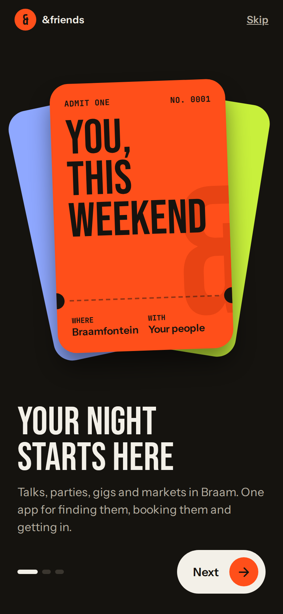
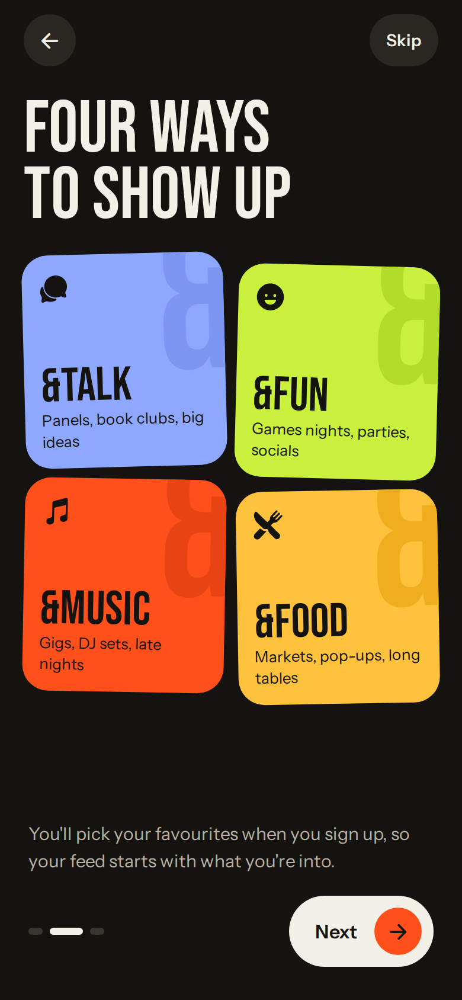
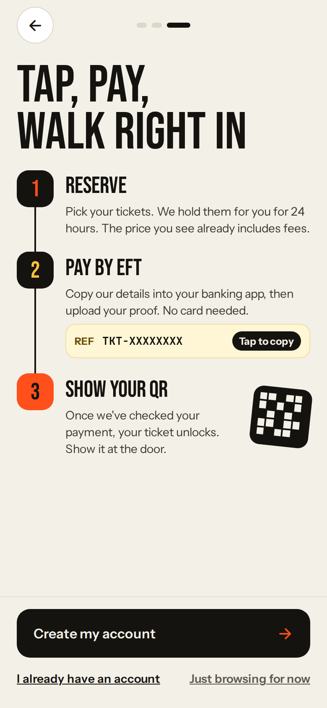
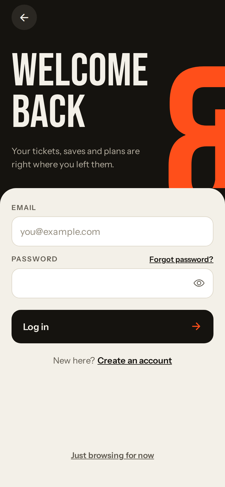
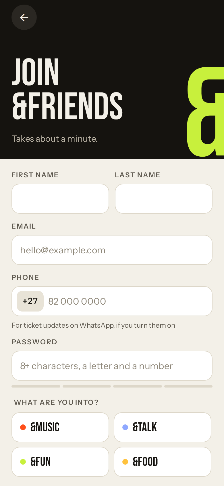
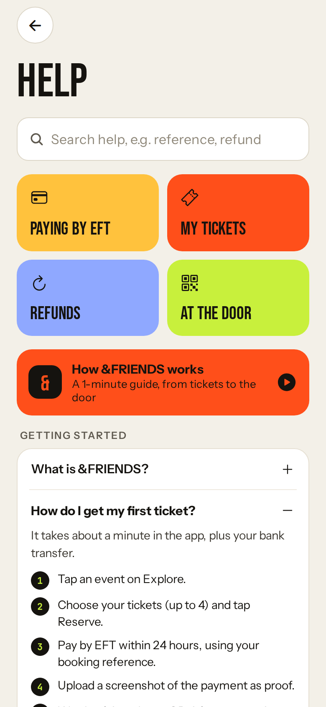

<p align="center">
  
</p>

<p align="center">
  <b>Braamfontein's events app.</b> Find a night out, reserve tickets, pay by EFT and walk in with a QR code.
</p>

<p align="center">
  <a href="https://github.com/42seconds/friends-app/releases/latest"><b>Download for Android</b></a> ·
  <a href="#iphone-and-web">iPhone and web</a> ·
  <a href="#run-it-yourself">Run it yourself</a>
</p>

---

## The app

<p align="center">
  
  
  
</p>
<p align="center">
  
  
  
</p>

&FRIENDS brings Braamfontein's gigs, talks, games nights, markets and food pop-ups into one
app, grouped into four sub-brands: **&Music**, **&Talk**, **&Fun** and **&Food**.

**For guests**
- Browse this week's events, filter by sub-brand, price and date, search and save events
- Reserve up to 4 tickets. They are held for 24 hours while you pay by EFT
- Copy the bank details and booking reference, upload proof of payment, and follow the check on a live timeline
- Get a notification the moment your payment is approved, then show one QR code at the door
- Send a ticket to a friend, release it to the waitlist, or join the waitlist for sold-out nights
- A first-time guide, one-time tips on the real screens, and a guided first payment
- A searchable help page with step-by-step answers
- Works offline: saved events, bookings and QR tickets open without signal

**For staff**
- Review proofs of payment and approve or reject them with a reason
- Scan QR codes at the door (scans made offline sync later), and search the guest list

**Accounts**
- Register and log in with email and password (passwords are hashed by Firebase Authentication)
- Continue with Google (single sign-on)
- Password reset by email, editable profile, notification settings and a 5-second log-out

## Get the app

### Android

1. Open the [latest release](https://github.com/42seconds/friends-app/releases/latest) and download the `.apk` file.
2. Open it on your phone and allow installing from this source when asked.

Every push also builds an APK in [GitHub Actions](https://github.com/42seconds/friends-app/actions)
(open a green run and download it under **Artifacts**).

### iPhone and web

iPhones only install apps through the App Store or TestFlight, which need an Apple Developer
account. Until then, iPhone users can:

- **Open the web version** in Safari, then tap **Share → Add to Home Screen**. It uses the same
  database and accounts as the Android app.
- **Use Expo Go**: install Expo Go from the App Store and scan the QR code from `npx expo start`.

Google sign-in, push notifications and offline mode need the installed app.

## Run it yourself

You need [Node.js 22](https://nodejs.org) and Git.

```bash
git clone https://github.com/42seconds/friends-app.git
cd friends-app
npm install --legacy-peer-deps
npx expo start
```

Scan the QR code with **Expo Go** (Android) or the **Camera** app (iPhone), or press **w** to open
it in the browser. If your phone can't connect, use `npx expo start --tunnel`.

| Command | What it does |
|---|---|
| `npm test` | Unit tests (Jest) |
| `npm run typecheck` | TypeScript check |
| `npm run test:rules` | Firestore security rules tests on the local emulator |
| `npm run seed` | Adds sample data (10+ records per collection) |
| `npm run deploy:web` | Builds and publishes the web version to Firebase Hosting |

## How it's built

| Part | Technology |
|---|---|
| App | React Native with Expo (SDK 57), Expo Router, TypeScript |
| Database | Cloud Firestore, with security rules for residents and admins |
| Accounts | Firebase Authentication (email and password, Google sign-in) |
| Notifications | Expo Notifications and Expo push service |
| Offline | Data saved on the phone (AsyncStorage) and NetInfo |
| Tests | Jest unit tests, Firestore rules tests on the Firebase emulator |
| CI/CD | GitHub Actions and Azure Pipelines (test, build the APK, deploy the web version) |
| Planning | Azure Boards (epics, features, user stories over 7 sprints) |

```
app/            screens (Expo Router: one file per screen)
src/
  components/   shared UI (buttons, cards, coach marks, offline banner)
  services/     Firebase: auth, events, tickets, payments, users
  hooks/        data hooks (events, bookings, tickets, profile)
  lib/          pure logic: pricing, dates, validation, offline cache, push
__tests__/      unit tests
tests/rules/    Firestore security rules tests
docs/           Azure DevOps setup, push notifications, website notes
```

## DevOps

- **GitHub Actions** ([`.github/workflows/ci.yml`](.github/workflows/ci.yml)): typecheck, unit tests,
  Firestore rules tests and an Android APK on every pull request.
- **Azure Pipelines** ([`azure-pipelines.yml`](azure-pipelines.yml)): Test, Build (APK) and Deploy
  (web version to Azure Static Web Apps).
- **Azure Boards**: the full backlog and sprints. Commits that mention `AB#<id>` link to their work
  item. Setup steps are in [`docs/azure-devops`](docs/azure-devops/README.md).

## Team

| Name | Student number 
|---|---|
| Ivant Junior Kaptue Wambo | ST10448302 |
| Ayanda Magocoba | ST10351403| 
| Kgahlisho Mokoala| ST10325173| 

## License

See [LICENSE](LICENSE).
